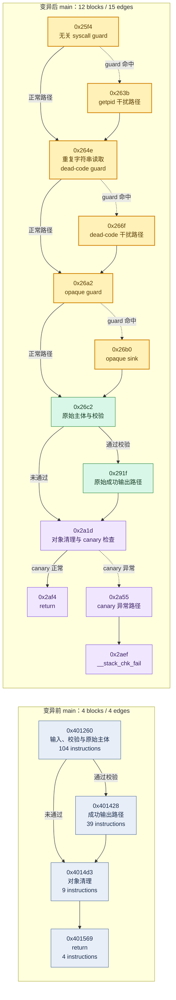

# MyBench automated pwn/rev mutator and validator

这是一个针对 `CTFbench` 的自动化变异器和验证器雏形。它以
`development_dataset.json` 和 `test_dataset.json` 为唯一题目清单来源，自动发现
全部 `pwn` 和 `rev` 题目，不依赖人工维护题目路径。

当前实现覆盖异构题目：

- 有 C/C++/Objective-C、Go、Python、JavaScript/TypeScript、Rust 或 Java 源码的题目：对
  优先源码注入一个确定性的 opaque guard。guard 使用语言对应的无副作用构造，正常执行路径
  不改变题目输出；变异结果包含源码哈希和完整 provenance。
- C/C++、Objective-C、Go 或 Rust 源码旁边如果存在同 basename 的已部署制品，生成器会在隔离的
  构建过程中分别尝试 `gcc/g++`、`clang/clang++`、`go` 或 `rustc`，并要求输出格式和架构与
  seed 一致。Java 只有在同 basename 的 `.class` 存在时才用匹配 class major version 的
  `javac --release` 重建；Docker `gcc:12-bookworm` fallback 只用于 C/C++。只有
  `compiled_artifact_rebuild` 成功且格式、hash、注入 marker 和 CFG witness 都通过，才把它计为
  可执行题目的实质变异。
- 对只有预编译原生入口、无法从源码重建的题目，或只有原生插件/内核模块而没有可执行
  wrapper 的题目，生成器会分析 `main`/`entry0` 及其他用户函数，把一个
  同长度的 x86 条件跳转或 AArch64 条件跳转改成无条件跳转，并重新计算 CFG witness。
  这条 `binary_cfg_mutation` 路径直接修改变体中的实际 ELF/Mach-O/PE，保留 seed 不变；
  没有可安全改写的分支时只记录 `binary_cfg_mutation_skipped`，绝不把 wrapper 当成变异。
- 上述语言的源码注入器覆盖当前数据集中的语言样本；无法解析入口、源码不是候选文件或没有
  候选源码时，仍会记录 `source_mutation_skipped` 和原因。它们不会被注释、模块变量或其他
  无效果标记冒充成已变异。
- 没有同 basename 部署制品的 source-only 题会保留源码级变异，并把 rebuild 记录为
  `required: false`；有匹配制品但工具链、链接或依赖失败时，会回滚源码和 noise，避免留下
  “源码变了、实际运行 binary 没变”的假变体。C/C++/Objective-C/Go/Rust/Java 的匹配制品
  都遵守这一规则，回滚原因写入 manifest。
- 只有预编译 ELF、脚本、压缩包或自定义 VM 的题目：生成可执行的
  `run_variant.sh` 入口包装，注入可复现的 variant/parent 环境标识，并记录降级路径。
- `run_variant.sh` 和 `variant_runtime.json` 是运行时打包/元数据操作，不计作源码级的
  pwn/rev 变异。
- 所有变体都复制题目目录，但默认使用 hardlink + copy-on-write，避免为 110 道题重复
  占用数百 MB；写入变异文件前会先解除 hardlink，不会修改 `CTFbench`。
- 公共 `challenge.json` 会移除 `flag`、`answer`、`solution`、`secret` 和 `key` 字段；
  明显的 `flag`、answer、solution、test_solver 和 writeup 文件也会从变体目录移除，
  manifest 只保存 secret 的哈希。被选中的源码会执行上面的源码级变异；未被选中的
  源码和压缩包不会被自动重写，其中的内嵌常量会在 manifest 中明确标记为未脱敏，
  便于后续接入专门的 oracle 分离流程。
- 验证器检查题目清单文件、声明的题目文件、opaque guard 符号、变异哈希、入口包装和
  manifest 一致性，并重新读取二进制补丁位置、哈希和 CFG witness。报告中的
  `substantive_artifact_mutations` 单独统计真实部署制品变异，避免“验证通过”被误读为
  “每道题都发生了实质变异”。`--build` 可选地在临时的完全脱离 hardlink 的副本中运行
  Makefile；默认不执行任意题目服务或 Docker，以保持批量生成稳定并避免污染种子。

### 分析干扰策略

源码变异默认加入四类与题目逻辑无关的分析干扰：`decoy_function_injection` 生成正常路径不
调用的无害函数（Go 在 false guard 下保留引用，Rust 用 `black_box` 保留函数指针），
`dead_code_injection` 生成确定为假的局部路径，
`duplicate_string_injection` 保留重复字符串常量，`irrelevant_syscall_injection` 在
不可达 guard 内保留只读进程 ID 调用（C/C++ 使用 `getpid`，脚本和 JVM/Go/Rust 使用其
标准库等价接口）。四类操作现在支持 C/C++/Objective-C、Python、Go、Rust、Java 和 JS/TS；
每个操作都记录策略、语言、marker 以及前后 SHA-256。

策略写入每个 `mutation_manifest.json`，并明确排除控制流平坦化、OLLVM 家族、packing
和 shell loader。机器可读示例见 [`noise_policy.example.json`](noise_policy.example.json)
和 [`noise_policy.schema.json`](noise_policy.schema.json)。可通过完整示例或内嵌
`noise_policy` 对象传给 `generate`/`pipeline`：

```bash
uv run mybench pipeline --ctfbench ../CTFbench --output ./generated \
  --category pwn rev --noise-policy ./noise_policy.example.json --clean
```

将某个 `limits` 项设为 `0` 会保留该 operator 的 skipped provenance。生成器只使用
普通源码级构造，不实现控制流平坦化、虚拟化、加壳或壳加载器。

### 实例：`2016q-rev-rock` 的 CFG 前后对比

下面比较 seed 中的 `rock` 和 `generated/variants/rev/development/2016q-rev-rock__v01/rock`。
节点和边来自 radare2 对真实二进制 `main` 的 `afbj` 结果；图中只压缩了基本块内的指令文本，
没有凭空补画控制流。地址变化是因为 seed 与本机重建产物的装载布局不同，不影响拓扑比较。

| 指标 | 变异前 | 变异后 | 变化 |
| --- | ---: | ---: | ---: |
| 基本块 | 4 | 12 | +200% |
| CFG 边 | 4 | 15 | +275% |
| 条件分支点 | 1 | 5 | +400% |
| `main` 指令数 | 156 | 235 | +50.6% |



黄色节点是 MyBench 注入的三个条件干扰区域，绿色节点是原题主逻辑，紫色节点是重建产物中的
清理和栈保护路径。仅看注入区域，`main` 已增加三组 diamond 分支；整体基本块变为 3 倍、边变为
3.75 倍，且正常执行仍沿实线绕过干扰体。这个幅度已经满足“肉眼可辨”的复杂度目标，因此没有
继续增加分支数量。继续堆叠会放大编译失败面和性能扰动，却不会提供同等价值的新分析结构。

可用下面的命令复核原始数据：

```bash
r2 -2 -q -c 'aa; afbj @ main; q' ../CTFbench/development/2016/CSAW-Quals/rev/Rock/rock
r2 -2 -q -c 'aa; afbj @ main; q' generated/variants/rev/development/2016q-rev-rock__v01/rock
```

### 当前手法与样本覆盖

下面的“生效”表示对应 operation 的 `changed: true`，并且变体中的源码或部署制品通过了后置校验。
以下统计来自当前数据集的 110 个变体；每个样本的具体文件、哈希和跳过原因以
`mutation_manifest.json` 为准。

| operation | 实现条件 | 生效样本 |
| --- | --- | --- |
| `opaque_guard_injection` | 在 C/C++/Objective-C、Python、Go、Rust、Java、JS/TS 的可解析入口加入确定性 false guard。 | 39 个：C/Objective-C 16 个（`2014f-pwn-kernel`、`2016q-pwn-hungman`、`2017q-rev-tablez`、`2018q-pwn-bigboy`、`2018q-pwn-shellpointcode`、`2019q-pwn-pop_goes_the_printer`、`2019q-rev-beleaf`、`2020q-pwn-thebardsfail`、`2020q-rev-baby_mult`、`2020q-rev-ezbreezy`、`2021q-pwn-haystack`、`2021q-pwn-krypto`、`2023q-pwn-puffin`、`2023q-pwn-target_practice`、`2023q-rev-baby_s_third`、`2023q-rev-whataxor`），C++ 3 个（`2016q-rev-rock`、`2017q-pwn-pilot`、`2017q-rev-prophecy`），Python 14 个（`2017q-rev-grumpcheck`、`2017q-rev-realism`、`2018f-rev-bdos`、`2018f-rev-free_as_in_freedom`、`2018q-rev-a_walk_through_x86_part_1`、`2020q-pwn-slithery`、`2021f-rev-maze`、`2021f-rev-sfc`、`2021q-rev-checker`、`2021q-rev-ncore`、`2022q-rev-anyagacha`、`2022q-rev-the_big_bang`、`2023q-pwn-my_first_pwnie`、`2023q-rev-baby_s_first`），Go 3 个（`2017q-rev-gopherz`、`2018f-pwn-es1337`、`2021q-rev-macomal`），Rust 2 个（`2017f-rev-rusty_road`、`2020f-rev-yeet`），Java 1 个（`2022f-rev-roulette`）。 |
| `decoy_function_injection` | 支持 C/C++/Objective-C、Python、Go、Rust、Java、JS/TS；注入正常路径不调用的无害函数或方法，并保留 marker/hash provenance。 | 39 个：`2014f-pwn-kernel`、`2016q-pwn-hungman`、`2016q-rev-rock`、`2017q-pwn-pilot`、`2017q-rev-prophecy`、`2017q-rev-tablez`、`2018q-pwn-bigboy`、`2018q-pwn-shellpointcode`、`2019q-pwn-pop_goes_the_printer`、`2019q-rev-beleaf`、`2020q-pwn-thebardsfail`、`2020q-rev-baby_mult`、`2020q-rev-ezbreezy`、`2021q-pwn-haystack`、`2021q-pwn-krypto`、`2023q-pwn-puffin`、`2023q-pwn-target_practice`、`2023q-rev-baby_s_third`、`2023q-rev-whataxor`、`2017q-rev-grumpcheck`、`2017q-rev-realism`、`2018f-rev-bdos`、`2018f-rev-free_as_in_freedom`、`2018q-rev-a_walk_through_x86_part_1`、`2020q-pwn-slithery`、`2021f-rev-maze`、`2021f-rev-sfc`、`2021q-rev-checker`、`2021q-rev-ncore`、`2022q-rev-anyagacha`、`2022q-rev-the_big_bang`、`2023q-pwn-my_first_pwnie`、`2023q-rev-baby_s_first`、`2017q-rev-gopherz`、`2018f-pwn-es1337`、`2021q-rev-macomal`、`2017f-rev-rusty_road`、`2020f-rev-yeet`、`2022f-rev-roulette`。语言分组为 C/Objective-C 16、C++ 3、Python 14、Go 3、Rust 2、Java 1。 |
| `dead_code_injection` | 在支持语言中加入由确定性 false 条件保护的局部路径；不会改变题目正常输出。 | 与 `decoy_function_injection` 相同的 39 个样本。 |
| `duplicate_string_injection` | 在支持语言中保留重复字符串字面量，并通过无关 helper 保持其在源码/产物中可见。 | 与 `decoy_function_injection` 相同的 39 个样本。 |
| `irrelevant_syscall_injection` | 在不可达 guard 中加入只读进程 ID 调用（C/Go/Python/JS 等使用对应平台 API；Rust/Java 使用对应标准库），结果不参与题目逻辑。 | 与 `decoy_function_injection` 相同的 39 个样本。 |
| `compiled_artifact_rebuild` | 对同 basename 的本地制品重建；校验格式、架构、哈希、所有注入 marker 和 CFG witness。 | 18 个：`2016q-pwn-hungman`、`2016q-rev-rock`、`2017f-rev-rusty_road`、`2017q-pwn-pilot`、`2017q-rev-prophecy`、`2017q-rev-tablez`、`2018q-pwn-bigboy`、`2018q-pwn-shellpointcode`、`2019q-rev-beleaf`、`2020q-pwn-thebardsfail`、`2020q-rev-baby_mult`、`2020q-rev-ezbreezy`、`2021q-pwn-haystack`、`2022f-rev-roulette`、`2023q-pwn-puffin`、`2023q-pwn-target_practice`、`2023q-rev-baby_s_third`、`2023q-rev-whataxor`。 |
| `binary_cfg_mutation` | 没有可用源码重建时，目标必须是 ELF/Mach-O/PE，且 radare2 找到可保持指令长度的条件跳转。 | 62 个：`2013q-pwn-csaw_diary`、`2014q-pwn-ish`、`2014q-pwn-the_road_less_traveled`、`2014q-rev-aerosol_can`、`2015f-pwn-hipster`、`2015f-rev-wyvern2`、`2015q-pwn-meme_shop`、`2015q-rev-ftp`、`2015q-rev-wyvern`、`2016f-pwn-detective`、`2016f-rev-palo_alto`、`2016q-pwn-tutorial`、`2016q-pwn-warmup`、`2016q-rev-deedeedee`、`2017f-pwn-humm_sch_t`、`2017f-rev-48_bit_yeet_lab`、`2017f-rev-rabbithole`、`2017q-pwn-zone`、`2017q-rev-bananascript`、`2017q-rev-gopherz`、`2017q-rev-grumpcheck`、`2018f-pwn-es1337`、`2018f-rev-1nsayne`、`2018q-pwn-get_it`、`2018q-rev-kvm`、`2019f-pwn-arevenge`、`2019f-rev-steady_counting`、`2019f-rev-wrangly`、`2019q-pwn-baby_boi`、`2019q-pwn-got_milk`、`2019q-pwn-pop_goes_the_printer`、`2019q-pwn-popping_caps`、`2019q-pwn-popping_caps_2`、`2019q-pwn-traveller`、`2019q-rev-call_site`、`2019q-rev-gibberish_check`、`2019q-rev-wizkid`、`2020f-rev-brrr`、`2020f-rev-rap`、`2020f-rev-yeet`、`2020q-pwn-blox2`、`2020q-pwn-feather`、`2020q-pwn-grid`、`2020q-pwn-roppity`、`2020q-rev-not_malware`、`2021f-pwn-chatterbox`、`2021f-pwn-horrorscope`、`2021f-rev-maze`、`2021q-pwn-alien_math`、`2021q-pwn-password_checker`、`2021q-rev-ransomware`、`2022f-pwn-salt_server`、`2022f-rev-parallel_vm`、`2022q-pwn-unsafe_linking`、`2022q-rev-game`、`2023f-pwn-virtualization_pwn`、`2023f-rev-unvirtualization`、`2023f-rev-virtualization`、`2023q-pwn-unlimited_subway`、`2023q-rev-rebug_1`、`2023q-rev-rebug_2`、`2023q-rev-rox`。 |

`runtime_entrypoint_wrapper`（96 个）和 `runtime_metadata_overlay`（14 个）只负责打包入口和注入环境标识，不计作源码或二进制实质变异。
上表按当前工具链的全量报告统计；`2022f-rev-roulette` 只有在 `chall.class` 存在且
`javac --release` 重建成功时才进入清单。若该匹配制品的编译失败，源码和四类 noise 会一起
回滚；没有匹配制品的 Java 题则保留 source-only 变异。

### 为什么其它样本被跳过

现在没有样本因为语言注入器缺失而跳过。全量中每个源码样本的四类 noise 都先完成语言级注入；最终仍为 `changed: false` 的四类 noise 各有 48 个，原因都是 C/C++ 制品重建失败后恢复源码，避免留下“源码变了、实际运行 binary 没变”的假变体。这 48 个是：

`2014q-pwn-the_road_less_traveled`、`2015q-pwn-meme_shop`、`2016f-pwn-detective`、`2016q-pwn-tutorial`、`2016q-pwn-warmup`、`2017f-rev-48_bit_yeet_lab`、`2017f-rev-rabbithole`、`2017q-pwn-zone`、`2018q-pwn-get_it`、`2018q-rev-kvm`、`2019f-pwn-arevenge`、`2019f-rev-mystery_boi`、`2019f-rev-wrangly`、`2019q-pwn-baby_boi`、`2019q-pwn-got_milk`、`2019q-pwn-popping_caps`、`2019q-pwn-popping_caps_2`、`2019q-pwn-small_boi`、`2019q-pwn-traveller`、`2019q-rev-call_site`、`2019q-rev-gibberish_check`、`2019q-rev-halfpike`、`2020f-pwn-darkunion1`、`2020f-rev-brrr`、`2020f-rev-rap`、`2020q-pwn-feather`、`2020q-pwn-grid`、`2020q-pwn-roppity`、`2020q-rev-not_malware`、`2021f-pwn-chatterbox`、`2021f-pwn-horrorscope`、`2021q-pwn-alien_math`、`2021q-pwn-password_checker`、`2021q-rev-ransomware`、`2022f-pwn-cryptopwn`、`2022f-pwn-salt_server`、`2022f-rev-parallel_vm`、`2022q-pwn-ezrop`、`2022q-pwn-unsafe_linking`、`2022q-rev-game`、`2023f-pwn-brainflop`、`2023f-pwn-virtualization_pwn`、`2023f-rev-cell`、`2023f-rev-virtualization`、`2023q-pwn-unlimited_subway`、`2023q-rev-rebug_1`、`2023q-rev-rebug_2`、`2023q-rev-rox`。

`opaque_guard_injection` 另外有 23 个 skipped，因为没有候选源码：`2013q-pwn-csaw_diary`、`2014f-rev-odd`、`2014f-rev-return_of_the_weiner`、`2014q-pwn-ish`、`2014q-rev-aerosol_can`、`2014q-rev-weissman`、`2015f-pwn-hipster`、`2015f-rev-wyvern2`、`2015q-rev-ftp`、`2015q-rev-wyvern`、`2016f-rev-palo_alto`、`2016q-rev-deedeedee`、`2017f-pwn-humm_sch_t`、`2017q-rev-bananascript`、`2018f-rev-1nsayne`、`2018q-rev-a_walk_through_x86_part_2`、`2019f-rev-steady_counting`、`2019q-rev-wizkid`、`2020f-rev-sourcery`、`2020q-pwn-blox2`、`2020q-pwn-pwnvoltex`、`2022q-rev-dockreleakage`、`2023f-rev-unvirtualization`。这些题只有预编译入口、数据或非候选源码，源码注入无法证明会进入运行路径。

`compiled_artifact_rebuild` 的 69 个 skipped 分成三类。40 个没有和源码同 basename 的本地制品，
所以保留 source-authoritative 变异：`2014f-pwn-kernel`、`2014q-pwn-the_road_less_traveled`、
`2015q-pwn-meme_shop`、`2017f-rev-rabbithole`、`2017q-pwn-zone`、`2017q-rev-gopherz`、
`2018f-pwn-es1337`、`2019f-pwn-arevenge`、`2019f-rev-mystery_boi`、`2019q-pwn-got_milk`、
`2019q-pwn-pop_goes_the_printer`、`2019q-pwn-popping_caps`、`2019q-pwn-popping_caps_2`、
`2019q-pwn-traveller`、`2019q-rev-call_site`、`2019q-rev-halfpike`、`2020f-pwn-darkunion1`、
`2020f-rev-brrr`、`2020f-rev-rap`、`2020f-rev-yeet`、`2020q-pwn-grid`、`2020q-rev-not_malware`、
`2021f-pwn-chatterbox`、`2021f-pwn-horrorscope`、`2021q-pwn-krypto`、`2021q-rev-macomal`、
`2021q-rev-ransomware`、`2022f-pwn-cryptopwn`、`2022f-pwn-salt_server`、`2022f-rev-parallel_vm`、
`2022q-pwn-ezrop`、`2022q-pwn-unsafe_linking`、`2023f-pwn-brainflop`、`2023f-pwn-virtualization_pwn`、
`2023f-rev-cell`、`2023f-rev-virtualization`、`2023q-pwn-unlimited_subway`、`2023q-rev-rebug_1`、
`2023q-rev-rebug_2`、`2023q-rev-rox`。其中 `2019q-pwn-pop_goes_the_printer` 的 Objective-C
源码仍然有效，跳过的只是没有同名部署制品。
另有 14 个 source-only 样本没有部署制品：`2017q-rev-grumpcheck`、`2017q-rev-realism`、
`2018f-rev-bdos`、`2018f-rev-free_as_in_freedom`、`2018q-rev-a_walk_through_x86_part_1`、
`2020q-pwn-slithery`、`2021f-rev-maze`、`2021f-rev-sfc`、`2021q-rev-checker`、
`2021q-rev-ncore`、`2022q-rev-anyagacha`、`2022q-rev-the_big_bang`、
`2023q-pwn-my_first_pwnie`、`2023q-rev-baby_s_first`。最后 15 个存在匹配制品但编译、链接、架构
或依赖不兼容：`2016f-pwn-detective`、`2016q-pwn-tutorial`、`2016q-pwn-warmup`、
`2017f-rev-48_bit_yeet_lab`、`2018q-pwn-get_it`、`2018q-rev-kvm`、`2019f-rev-wrangly`、
`2019q-pwn-baby_boi`、`2019q-pwn-small_boi`、`2019q-rev-gibberish_check`、`2020q-pwn-feather`、
`2020q-pwn-roppity`、`2021q-pwn-alien_math`、`2021q-pwn-password_checker`、`2022q-rev-game`。
失败原因包括旧汇编语法、缺失外部符号、旧式 `gets`/系统 API、C++ 标准版本、重复 `_start`
以及题目自带依赖；这些不是语言注入器跳过，manifest 会保存编译器尾部输出。

`binary_cfg_mutation` 的 22 个 skipped 中，18 个入口不是 ELF/Mach-O/PE，分别是脚本、数据、压缩内容或其它非原生载荷；`2019q-pwn-small_boi` 和 `2022q-rev-anyagacha` 没有可保持指令长度的条件跳转；`2014f-rev-odd` 和 `2021q-rev-macomal` 无法由 radare2 分析 `main`/`entry0`。wrapper 本身从不作为 CFG 变异目标。

因此，当前“语言导致的跳过”已经消除；剩余 skipped 只对应没有源码、没有可映射部署制品、工具链/依赖失败或无法证明二进制 CFG 变化，并在 manifest 中保留具体原因。

## 快速开始

项目使用 `mise` 固定工具链、使用 `uv` 管理环境和 Python 命令。在 `MyBench/` 目录执行：

```bash
mise install
mise run install

mise run discover
mise run pipeline
```

等价的 `uv` 命令是：

```bash
uv sync
uv run mybench discover --ctfbench ../CTFbench --split all --category pwn rev
uv run mybench pipeline \
  --ctfbench ../CTFbench \
  --split all \
  --category pwn rev \
  --output ./generated \
  --variants-per-seed 1 \
  --noise-policy ./noise_policy.example.json \
  --clean
```

成功后可以查看：

- `MyBench/generated/catalog.json`：发现到的 seed、变体数量和相对路径；
- `MyBench/generated/validation_report.json`：每个实例的检查结果；
- `MyBench/generated/variants/<category>/<split>/<variant>/mutation_manifest.json`：
  单个变体的父题、操作、哈希、entrypoint、构建提示和可复现种子；
- 每个变体目录中的 `MUTATION.md`、`run_variant.sh`（若发现安全入口）或
  `variant_runtime.json`（没有安全入口时）。

基于当前仓库的全量运行（pwn 49、rev 61，共 110 个变体），验证结果为 110/110
通过；其中 80 个变体发生了部署制品级变异（`compiled_artifact_rebuild` 18 个、
`binary_cfg_mutation` 62 个），39 个变体完成了 `opaque_guard_injection`，39 个变体
完成了四类源码分析干扰。源码干扰和部署制品变异可以重叠；skipped 只表示对应操作的
前置条件不满足，不表示变体验证失败。下面的样本清单来自同一批
`mutation_manifest.json`，重新生成数据集后应以 manifest 中的实际清单为准。

## 命令

```bash
# 只枚举题目
uv run mybench discover --ctfbench ../CTFbench --split development --category pwn rev

# 生成变体，不验证
uv run mybench generate --ctfbench ../CTFbench --output ./generated \
  --variants-per-seed 2 --clean

# 验证已有生成目录
uv run mybench validate --input ./generated

# 验证并在存在 Makefile 时尝试构建；构建失败会记录为 warning，题目仍会保留
uv run mybench validate --input ./generated --build
```

## 变异契约和后续扩展

当前雏形的稳定契约是“题目目录和声明文件保持可用、满足前置条件的源码和实际部署
artifact 发生确定性变异、秘密不进入公共 metadata、所有操作可由 manifest 重放”。源码
变异、artifact 重建、运行时入口操作和明确跳过的源码变异分开记录，后续可以在同一接口下添加：

- C/C++ 的局部变量/结构体布局、编译保护、协议 wrapper；
- pwn 的堆分配序列、格式串栈噪声、PIE/Canary/RELRO 组合；
- rev 的常量拆分、状态机、字符串运行时解密和间接调用；
- Docker/compose 沙箱中的参考 solver 重放和隐藏 oracle；
- CFG/字符串相似度去重、ASLR 多轮验证和 fuzz/coverage witness。

这些增强应继续遵守 `mutation_manifest.json` 的 provenance 和后置验证接口，而不要
为不同题型添加人工维护的单题脚本。
